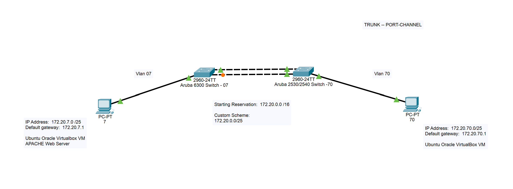
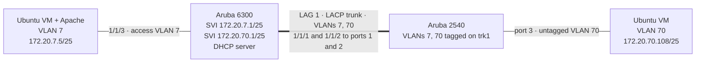

# Aruba 6300 & 2540: LACP Trunk, VLANs and Apache Web Server

A hands-on networking lab that links an **Aruba 6300 (AOS-CX)** and an **Aruba 2540** switch with a two-link **LACP trunk**, carries **VLAN 7** and **VLAN 70** across it, and routes between the VLANs on the 6300, which also runs the **DHCP server**. Two **Ubuntu 22.04 virtual machines**, one per VLAN, get their addressing from the 6300. The VLAN 7 VM hosts an **Apache web server** that the VLAN 70 VM reaches across the trunk, and every hop is checked with **SSH**, **HTTP** and **Wireshark** captures.


**Last updated:** November 2026

---

## 📚 Project Objectives

- Split the starting reservation `172.20.0.0/16` into `/25` subnets for VLAN 7 and VLAN 70
- Connect two switches (Aruba 6300 and Aruba 2540) with a two-port **LACP port-channel** trunk
- Carry VLANs 7 and 70 across the trunk and route between them on the 6300
- Run a **DHCP server on the 6300** with one pool per VLAN
- Connect one Ubuntu VM to each VLAN, one on each switch, and confirm they receive an address and default gateway from the 6300
- Install and configure an **Apache web server** on the VLAN 7 VM and reach it from the VLAN 70 VM
- Disable direct root login over SSH and connect over SSH between the VMs and to the switch
- Capture the SSH and HTTP traffic in **Wireshark** and verify the switch with `show` commands

---

## 🗺️ Network Topology





| VLAN | Name   | Network          | Gateway (SVI on 6300) | DHCP Pool                        | Access Port         |
|------|--------|------------------|-----------------------|----------------------------------|---------------------|
| 7    | VLAN7  | `172.20.7.0/25`  | `172.20.7.1`          | `172.20.7.1` – `172.20.7.126`    | 6300 port `1/1/3`   |
| 70   | VLAN70 | `172.20.70.0/25` | `172.20.70.1`         | `172.20.70.1` – `172.20.70.126`  | 2540 port `3`       |

Addresses handed out in the final run: `172.20.7.5` (VLAN 7 VM, Apache server) and `172.20.70.108` (VLAN 70 VM). See [docs/topology.md](docs/topology.md) for the full breakdown.

---

## 📂 Repository Layout

```
Aruba-6300-2540-LACP-Trunk-and-Apache-Web-Server/
├── configs/
│   ├── aruba-6300-switch.cfg        # 6300: DHCP pools, VLANs, SVIs, LAG 1, access port
│   ├── aruba-2540-switch.cfg        # 2540: LACP trunk and VLAN membership
│   └── sshd_config.snippet          # The sshd_config change made on the VMs
├── docs/
│   ├── topology.md                  # Addressing plan and design notes
│   ├── setup.md                     # Step-by-step build guide
│   ├── verification.md              # Every check, with expected output
│   └── submission.md                # Project summary and references
├── packet-tracer/
│   └── network-diagram.pkt          # Network diagram (Cisco Packet Tracer)
├── screenshots/                     # Proof of each deliverable
├── scripts/
│   └── verify-connectivity.bash     # Optional helper to run the VM-side checks
├── web/
│   └── index.html                   # Template for the Apache test page
├── .gitignore
└── README.md
```

---

## 🧰 Requirements

- Aruba 6300 switch running AOS-CX (CLI prompt `Switch-7#` in the captures)
- Aruba 2540 switch (ArubaOS-Switch CLI)
- Two cables between the switches for the LACP trunk
- Two Ubuntu 22.04 VMs (built in VMware Workstation), each with:
  - one adapter on the campus network (DHCP)
  - one adapter connected to the lab switches
- `openssh-server` and `apache2` on the VLAN 7 VM, `openssh-server` on the VLAN 70 VM
- Wireshark on the VMs for packet capture
- Cisco Packet Tracer to open the `.pkt` diagram

---

## ⚙️ Setup

Full walkthrough: [docs/setup.md](docs/setup.md). The short version:

1. Paste [configs/aruba-6300-switch.cfg](configs/aruba-6300-switch.cfg) into the Aruba 6300 CLI.
2. Paste [configs/aruba-2540-switch.cfg](configs/aruba-2540-switch.cfg) into the Aruba 2540 CLI.
3. Cable ports `1/1/1` and `1/1/2` on the 6300 to ports `1` and `2` on the 2540, the VLAN 7 VM to 6300 port `1/1/3`, and the VLAN 70 VM to 2540 port `3`.
4. On each VM, confirm the lab interface received an address from the switch:

   ```bash
   ip -brief link
   ip a
   ```

5. Install Apache on the VLAN 7 VM and publish the test page:

   ```bash
   sudo apt update
   sudo apt install -y apache2
   sudo systemctl enable --now apache2
   sudo cp web/index.html /var/www/html/index.html
   ```

6. Disable root login in `/etc/ssh/sshd_config` and restart SSH on both VMs:

   ```bash
   sudo vim /etc/ssh/sshd_config      # set: PermitRootLogin no
   sudo systemctl restart ssh
   ```

7. Create a key pair on each VM and copy the public key to the other VM:

   ```bash
   ssh-keygen
   ssh-copy-id <username>@<other-vm-ip>
   ```

8. From the VLAN 70 VM, browse to the web server and SSH to the other VM and the switch:

   ```bash
   links http://172.20.7.5
   ssh <username>@172.20.7.5
   ssh student@172.20.70.1
   ```

---

## 🖥️ Switch Configuration

The full files are in [configs/](configs/). Highlights:

**Aruba 6300** – DHCP, VLANs, gateways and the LAG towards the 2540

```
dhcp-server vrf default
    pool vlan7
        range 172.20.7.1 172.20.7.126
        default-router 172.20.7.1
        exit
    pool vlan70
        range 172.20.70.1 172.20.70.126
        default-router 172.20.70.1
        exit
    enable

interface vlan 7
    ip address 172.20.7.1/25
    no shutdown
interface vlan 70
    ip address 172.20.70.1/25
    no shutdown

interface lag 1
    no shutdown
    vlan trunk allowed 7,70
    exit
```

**Aruba 2540** – matching LACP trunk and VLAN membership

```
trunk 1,2 trk1 lacp

vlan 7
   tagged trk1
   exit
vlan 70
   tagged trk1
   untagged 3
   exit
```

---

## ✅ Usage & Verification

Every check below has expected output and a screenshot in [docs/verification.md](docs/verification.md).

**On the 6300**

```
Switch-7# sh ip int br
Interface         IP Address            Interface Status
                                        link/admin
vlan1             No Address            down/up
vlan7             172.20.7.1/25         up/up
vlan70            172.20.70.1/25        up/up
```

```
Switch-7# show vlan
VLAN  Name             Status  Reason                Type     Interfaces
1     DEFAULT_VLAN_1   down    no_member_forwarding  default  1/1/4-1/1/24,1/1/27-1/1/28
7     VLAN7            up      ok                    static   1/1/3,lag1
70    VLAN70           up      ok                    static   lag1
```

**On a VM** (VLAN 70 VM, excerpt)

```
$ ip route
default via 172.20.70.1 dev ens33 proto dhcp metric 20101
172.20.7.0/25 via 172.20.70.1 dev ens33
172.20.70.0/25 dev ens33 proto kernel scope link src 172.20.70.108 metric 101
```

**HTTP across the trunk** – the VLAN 70 VM requests the page from `172.20.7.5`, and Wireshark shows `GET / HTTP/1.1` answered with `HTTP/1.1 200 OK (text/html)`. The Ethernet destination of the request is the 6300's MAC address, which shows the traffic is routed by the 6300.

**SSH** – the VMs log in to each other across both switches and to the 6300 on its gateway addresses, and Wireshark shows the SSHv2 handshake (version exchange, key exchange init, Elliptic Curve Diffie-Hellman).

---

## 🔍 How It Works

1. **LACP trunk** – Ports `1/1/1` and `1/1/2` on the 6300 form `lag 1`, and ports `1` and `2` on the 2540 form `trk1` with LACP. The bundle carries VLANs 7 and 70 as tagged traffic.
2. **VLANs** – VLAN 7 has one access port (6300 `1/1/3`) and VLAN 70 has one untagged port (2540 port `3`), so each VM sits in its own Layer 2 broadcast domain.
3. **Routing** – The 2540 only switches. The 6300 holds both gateway interfaces (`interface vlan 7` and `interface vlan 70`) and routes between the two `/25` networks.
4. **DHCP** – The 6300's DHCP server answers requests from both VLANs, including the VLAN 70 requests that arrive over the trunk. `sh dhcp-server leases` lists the active leases.
5. **Routes on the VMs** – Each VM also has an adapter on the campus network, which wins the default route by metric. A static route to the other VLAN via the local gateway lets traffic cross the switches.
6. **Apache** – The VLAN 7 VM serves a test page from `/var/www/html`. The VLAN 70 VM reaches it at `http://172.20.7.5`, and Wireshark captures the request and the `200 OK` response.
7. **SSH** – The VMs set `PermitRootLogin no` and use an `ssh-keygen` key pair for each user (the VM-to-VM logins in the screenshots complete without a password prompt). The 6300 also accepts SSH on its gateway addresses, where the `student` account is prompted for a password.
8. **Spanning tree** – The 6300 runs MSTP and is the root bridge. Port `1/1/3` and `lag1` are forwarding.

---

## 🖼️ Screenshots

| # | Screenshot | File |
|---|------------|------|
| 1 | Network diagram | [01-network-diagram.png](screenshots/01-network-diagram.png) |
| 2 | SSH to the 6300 from the VLAN 70 VM (Wireshark) | [02-ssh-to-switch-vlan70-wireshark.png](screenshots/02-ssh-to-switch-vlan70-wireshark.png) |
| 3 | SSH to the 6300 from the VLAN 7 VM (Wireshark) | [03-ssh-to-switch-vlan7-wireshark.png](screenshots/03-ssh-to-switch-vlan7-wireshark.png) |
| 4 | SSH VLAN 70 VM → VLAN 7 VM | [04-ssh-vm-to-vm-vlan70-to-vlan7.png](screenshots/04-ssh-vm-to-vm-vlan70-to-vlan7.png) |
| 5 | SSH VLAN 7 VM → VLAN 70 VM | [05-ssh-vm-to-vm-vlan7-to-vlan70.png](screenshots/05-ssh-vm-to-vm-vlan7-to-vlan70.png) |
| 6 | HTTP request to the Apache server (Wireshark) | [06-apache-http-request-wireshark.png](screenshots/06-apache-http-request-wireshark.png) |
| 7 | `ip route` on the VLAN 70 VM | [07-ip-route-vlan70-vm.png](screenshots/07-ip-route-vlan70-vm.png) |
| 8 | `ip route` on the VLAN 7 VM | [08-ip-route-vlan7-vm.png](screenshots/08-ip-route-vlan7-vm.png) |
| 9 | `ip a` on the VLAN 70 VM | [09-ip-a-vlan70-vm.png](screenshots/09-ip-a-vlan70-vm.png) |
| 10 | `ip a` on the VLAN 7 VM | [10-ip-a-vlan7-vm.png](screenshots/10-ip-a-vlan7-vm.png) |
| 11 | `sshd_config` change (VLAN 7 VM) | [11-sshd-config-vlan7-vm.png](screenshots/11-sshd-config-vlan7-vm.png) |
| 12 | `sshd_config` change (VLAN 70 VM) | [12-sshd-config-vlan70-vm.png](screenshots/12-sshd-config-vlan70-vm.png) |
| 13 | `sh ip int br` | [13-show-ip-interface-brief.png](screenshots/13-show-ip-interface-brief.png) |
| 14 | `sh spanning-tree` | [14-show-spanning-tree.png](screenshots/14-show-spanning-tree.png) |
| 15 | `show vlan` | [15-show-vlan.png](screenshots/15-show-vlan.png) |
| 16 | `sh dhcp-server leases` | [16-show-dhcp-server-leases.png](screenshots/16-show-dhcp-server-leases.png) |
| 17 | Switch configuration scripts | [17-switch-configuration.png](screenshots/17-switch-configuration.png) |

---

## 📖 References

- [ArubaOS 8.x CLI Reference Guide](https://arubanetworking.hpe.com/techdocs/ArubaOS-8.x-Books/ArubaOS-8.x-CLI-Reference-Guide.pdf)
- [HPE Support – document a00021327en_us](https://support.hpe.com/hpesc/public/docDisplay?docId=a00021327en_us)
- [HPE Support – document a00055715en_us](https://support.hpe.com/hpesc/public/docDisplay?docId=a00055715en_us&docLocale=en_US)
