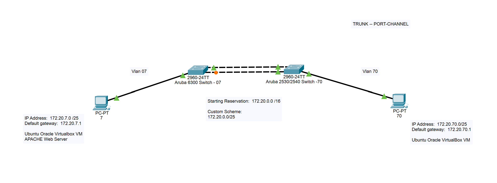

# 🗺️ Topology & Addressing Plan

This document describes the network designed for this lab.

The editable diagram is in [`packet-tracer/network-diagram.pkt`](../packet-tracer/network-diagram.pkt) (open with Cisco Packet Tracer).

---

## Devices

| Device | Role | Notes |
|--------|------|-------|
| Aruba 6300 switch | Layer 3 switch, DHCP server, SSH server, root bridge | Prompt `Switch-7#` in the captures. Drawn as a 2960-24TT icon in Packet Tracer |
| Aruba 2540 switch | Layer 2 switch (VLAN 7 and 70 trunk, VLAN 70 access port) | Labelled "Aruba 2530/2540 Switch -70" in the diagram. Drawn as a 2960-24TT icon in Packet Tracer |
| Ubuntu VM (VLAN 7) | Client and Apache web server | Ubuntu 22.04.5 LTS, VMware Workstation |
| Ubuntu VM (VLAN 70) | Client | Ubuntu 22.04.5 LTS, VMware Workstation |

> The diagram labels both VMs "Oracle VirtualBox". The screenshots show they ran in VMware Workstation.

---

## Addressing Scheme

- **Starting reservation:** `172.20.0.0/16`
- **Custom scheme:** `/25` subnets (128 addresses each, 126 usable hosts)
- The VLAN number is used as the third octet, which makes each network easy to recognise.

| VLAN | Name   | Network           | Netmask           | Gateway (SVI)  | Broadcast        |
|------|--------|-------------------|-------------------|----------------|------------------|
| 7    | VLAN7  | `172.20.7.0/25`   | `255.255.255.128` | `172.20.7.1`   | `172.20.7.127`   |
| 70   | VLAN70 | `172.20.70.0/25`  | `255.255.255.128` | `172.20.70.1`  | `172.20.70.127`  |

---

## Switch Ports

**Aruba 6300**

| Port              | Mode            | VLAN(s)  | Connected to              |
|-------------------|-----------------|----------|---------------------------|
| `1/1/1`, `1/1/2`  | Member of LAG 1 | 7, 70    | Aruba 2540 ports 1 and 2  |
| `lag1`            | Trunk (LACP)    | 7, 70    | Aruba 2540 `trk1`         |
| `1/1/3`           | Access          | 7        | Ubuntu VM (VLAN 7)        |

All other ports are disabled and part of the default VLAN 1 (see `show vlan` in [verification.md](verification.md)).

**Aruba 2540**

| Port        | Mode                | VLAN(s)           | Connected to             |
|-------------|---------------------|-------------------|--------------------------|
| `1`, `2`    | Member of `trk1`    | 7, 70 (tagged)    | Aruba 6300 `1/1/1`, `1/1/2` |
| `3`         | Untagged            | 70                | Ubuntu VM (VLAN 70)      |

---

## VM Network Interfaces

Each VM has two network adapters, and the adapter names differ between the VMs:

| VM        | Campus adapter (DHCP, `10.33.35.0/24`) | Lab adapter (DHCP from the 6300) |
|-----------|----------------------------------------|----------------------------------|
| VLAN 7    | `ens33`                                | `ens37`                          |
| VLAN 70   | `ens38`                                | `ens33`                          |

Because the campus adapter has the lower route metric (100), it holds the preferred default route. Each VM therefore has a static route to the other VLAN through its local gateway on the lab adapter:

| VM                           | Route to the other VLAN                        |
|------------------------------|------------------------------------------------|
| VLAN 7 VM (`172.20.7.5`)     | `172.20.70.0/25 via 172.20.7.1 dev ens37`      |
| VLAN 70 VM (`172.20.70.108`) | `172.20.7.0/25 via 172.20.70.1 dev ens33`      |

---

## DHCP Leases Observed

From `sh dhcp-server leases` on 16 May 2025:

| IP Address       | Hostname            | Notes |
|------------------|---------------------|-------|
| `172.20.7.5`     | `csp450`            | Ubuntu VM, VLAN 7 (Apache server) |
| `172.20.70.108`  | `ubuntuvm`          | Ubuntu VM, VLAN 70 |
| `172.20.7.118`   | `NHK1270-19-E063`   | Lab PC on the same VLAN |
| `172.20.70.84`   | `NHK1270-20-E1C2`   | Lab PC on the same VLAN |

---

## Design Notes

- The pools are `.1 – .126` in each VLAN, exactly as configured. They include the gateway address `.1`, so a tidier pool would be `.2 – .126`.
- The 2540 does not route. Every packet between VLAN 7 and VLAN 70 goes over the trunk to the 6300 and back, which is why the HTTP request in the Wireshark capture is addressed to the 6300's MAC address.
- Spanning tree runs in MSTP mode and the 6300 is the root bridge (priority 32768).
- The VLAN 70 VM's `ip a` output also shows a short-lived `172.20.7.108/25` address on its lab adapter. It looks like a leftover lease from before the VM was moved to VLAN 70 and does not affect the lab.
